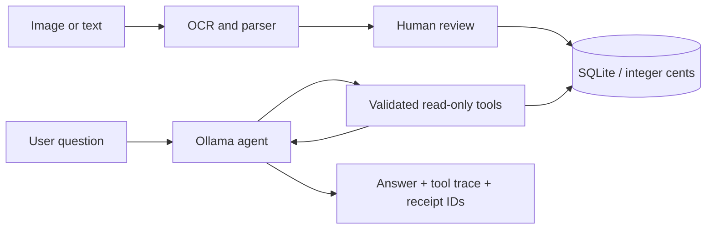

# SmartBake-AI — Receipt Analysis Agent

A local portfolio application that turns German bakery receipts into reviewable purchase records and answers questions using an LLM tool-calling agent.

**Python · Tesseract/OpenCV · SQLite · Ollama · Streamlit**

## Features

- German OCR for JPG/PNG receipts, product parsing and catalogue normalization.
- Human review for missing/inferred quantities and inconsistent totals.
- SQLite persistence, identical-file duplicate detection and integer-cent calculations.
- Four read-only agent tools: `search_receipts`, `summarize_purchases`, `check_receipt_errors`, `export_report`.
- Model-selected tools, receipt references and visible execution traces.
- CSV/JSON exports and a separate synthetic demo workspace.

## Quick start

Python 3.11 or newer:

```bash
python -m venv .venv
# Windows PowerShell:
.venv\Scripts\Activate.ps1
# Linux/macOS: source .venv/bin/activate
python -m pip install -r requirements.txt
python -m streamlit run app.py --server.address 127.0.0.1
```

Open the local URL printed by Streamlit. **Demo** loads two synthetic receipts dated **20–21 October 2026**. Expected values: 10 Croissants costing EUR 5.30; overall verified cost EUR 9.30; one inferred-quantity row excluded. Use explicit dates with this fixed demo. Overview and reports work without a model.

### Enable agent chat

Install [Ollama](https://ollama.com/), start it and install a tool-capable model:

```bash
ollama pull llama3.2
```

Select the installed model in the sidebar. The default endpoint is `http://127.0.0.1:11434`; no cloud API key is required. Try:

- How many Croissants did I buy in October 2026 and what did they cost?
- Which receipt rows need review?
- Prepare a purchase report from 2026-10-20 to 2026-10-21.

The agent follows the [Ollama tool-calling protocol](https://docs.ollama.com/capabilities/tool-calling), with five rounds maximum, validated tool arguments and date ranges. Tools cannot execute arbitrary SQL or write model-selected files. Purchase summaries use an English evidence template with exact EUR formatting and receipt citations, preventing model mistakes converting cents. Other replies are model-generated; multilingual quality is not guaranteed.

### Enable image OCR

Install [Tesseract](https://tesseract-ocr.github.io/tessdoc/Installation.html) with German `deu` language data. Put it on PATH or set `TESSERACT_CMD` to the executable. The usual Windows installation path is detected automatically. Verify `tesseract --list-langs` includes `deu`.

In **My receipts**, upload an image or UTF-8 OCR text, enter its date, extract and compare the table with the original. Correct missing values and clear an issue only after checking it. Confirm review and save. Arithmetic validity is recalculated on save; unresolved rows are excluded from summaries.

Supported layout (this is not a universal receipt parser):

```text
002601 W Croissant Butter 3,18 EUR
6 St 0,53 EUR/St
```

The catalogue is `config/product_mapping.csv`. Unknown IDs retain the OCR name; ambiguous IDs are not silently rewritten. Date extraction, tax reconciliation, credit notes and arbitrary receipt layouts are not implemented. Search matches product names or IDs, with a trailing English plural `s` fallback only when the literal search has no results.

### Batch extraction

```bash
python main.py --input data/demo
python main.py --input path/to/receipts --output data/output
```

Batch mode writes review-flagged CSV files without approving or importing them. Failed files and files with no recognized products cause a nonzero exit code.

## Architecture



`src/receipt_parser.py` handles extraction and review flags; `src/storage.py` owns persistence and calculations; `src/agent.py` implements the tool loop. `app.py` provides review, reports and chat. `main.py` retains the batch pipeline.

## Validation

```bash
python -m unittest discover -s tests -v
python scripts/evaluate_agent.py
```

The core suite tests quantity recovery, exact cents, review exclusion, duplicate prevention, date filters, SQL input handling, CSV escaping and mocked agent execution. CI runs it without downloading models. The optional evaluation calls local Ollama on synthetic questions and saves tool-level checks to `data/output/agent-evaluation.json`. These checks measure tool output, not full natural-language answer correctness.

## Limitations and data

This is a local single-user portfolio prototype, not a production accounting system. OCR omissions can go undetected; manual comparison is required. Identical-file hashing does not detect a rephotographed receipt. Saved imports cannot yet be edited in the UI: correct the draft before saving. Data represents purchases, not sales or inventory, and cannot justify production forecasts.

LLM replies may be wrong or omit tool calls. Inspect the tool evidence; no-tool replies are labelled unverified. Prompt instructions are not a guarantee against prompt injection, so tools are restricted to read-only analysis. Search results are capped at 100 rows with a truncation flag; summary calculations cover all matching rows.

Local databases, raw receipts, outputs and secrets are gitignored. Public demos use synthetic text only. An original receipt was present in earlier Git history; excluding it from the current tree does not remove that history. No history rewrite is performed.

